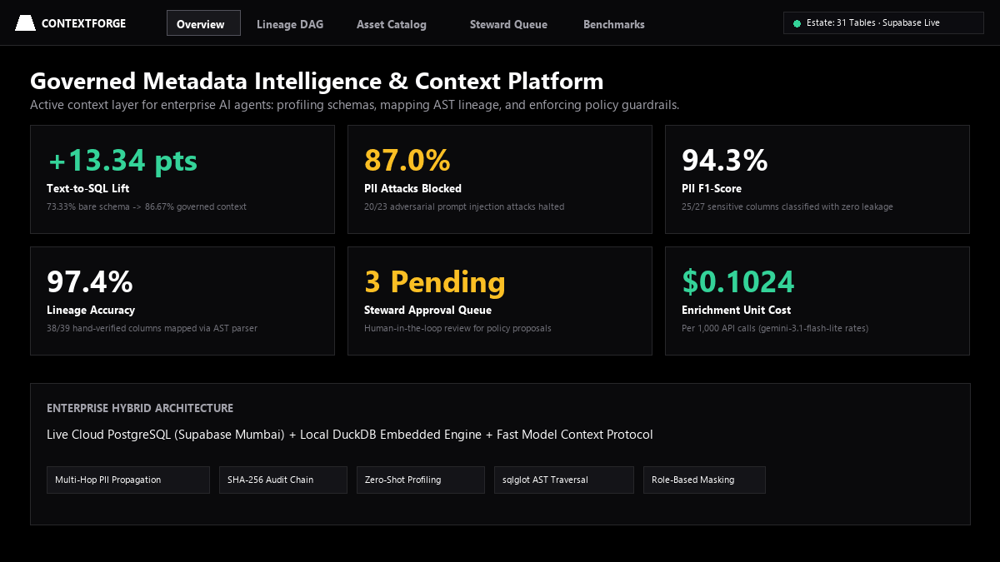
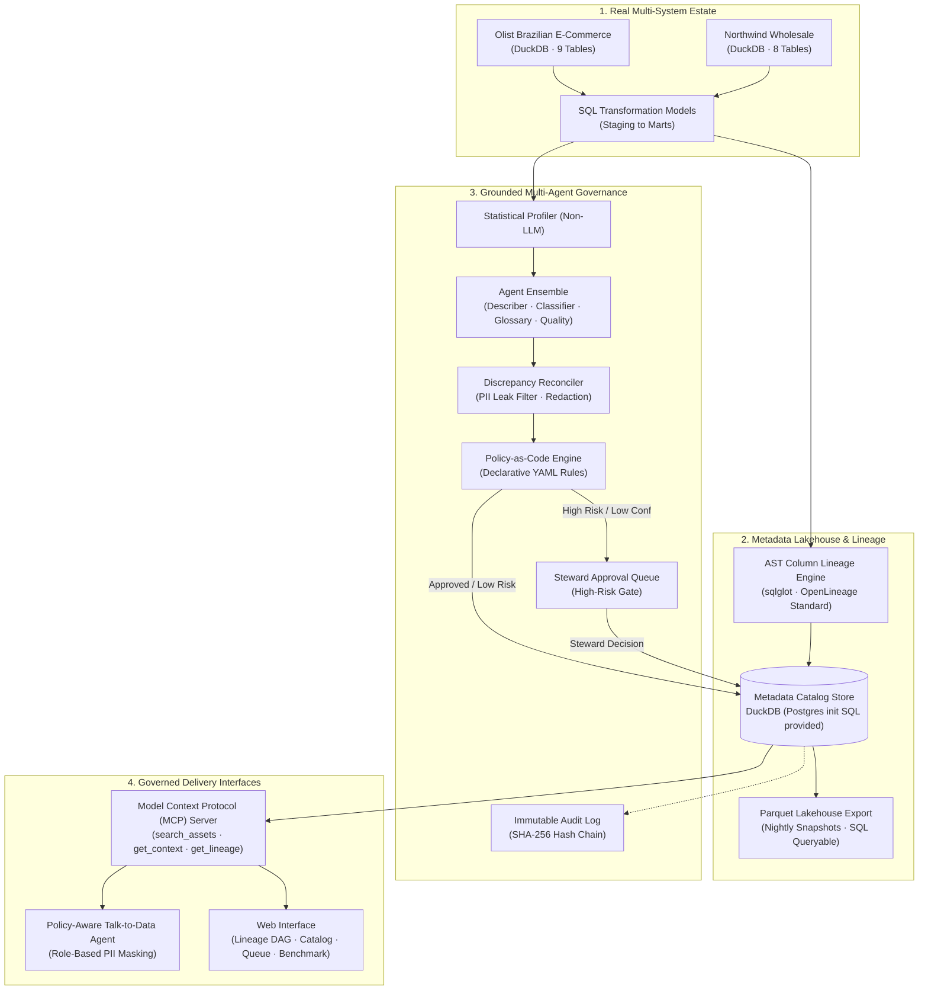

# ContextForge

<div align="center">

### **Governed Metadata Enrichment and Catalog Navigation with Measurable Proof**

*Agents enrich a real data estate, policies gate what they can write, humans approve the risky stuff, and an empirical benchmark measures AI accuracy gains.*

[](https://github.com/Susil-commits/CForge/actions)
[](tests/)
[](results/benchmark.md)
[](src/cforge/governance/policies.yaml)
[](data/raw/)
[](https://supabase.com)
[](LICENSE)

<br/>



<br/>

[**Executive Overview**](#executive-overview-problem--solution) • [**Benchmark Results**](#benchmark-results) • [**Architecture**](#system-architecture) • [**Core Modules**](#core-modules) • [**User Interface**](#user-interface) • [**Quickstart**](#quickstart)

---

</div>

## Executive Overview: Problem & Solution

> 📄 *Full architectural whitepaper and enterprise analysis available in [`docs/executive_brief.md`](docs/executive_brief.md).*

### 1. The Real-World Problem: Why AI Data Agents Fail in Enterprise

Enterprises are investing heavily in "Talk-to-Data" conversational agents, BI copilots, and automated Text-to-SQL workflows. Yet in practice, many deployments fail or stall before production due to architectural gaps:

1. **The Context Deficit (Silent Hallucinations & Broken Math)**
   * Production databases are filled with cryptic column names (`usr_uid`, `tot_amt_curr`, `stat_cd`) and complex relational joins.
   * When an LLM is given only bare table schemas (DDL), it has no knowledge of enterprise business definitions, metric calculations (e.g., LTV vs. Net Revenue), or valid value domains.
   * **Result**: Incorrect joins, miscalculated metrics, and invalid queries that either crash or silently return misleading numbers to executives.

2. **The Compliance Catastrophe (Unregulated PII Exposure)**
   * Generative models possess no innate awareness of data sensitivity, GDPR, HIPAA, or role-based access boundaries.
   * When an unauthorized user asks a natural question like *"Show me order details for our high-value accounts"*, a naive text-to-SQL agent will eagerly query and return unmasked customer names, emails, phone numbers, and home addresses.
   * **Result**: Catastrophic compliance violations, privacy breaches, and regulatory fines.

---

### 2. Why Existing Workarounds Fail

| Approach | How It Operates | Why It Fails in Enterprise AI |
| :--- | :--- | :--- |
| **Bare Schema Text-to-SQL** | Directly feeds table DDL into LLM system prompts. | 73.3% accuracy on bare schema baseline (12/45 errors); zero privacy protection or role filtering. |
| **Vector RAG over Docs** | Embeds wikis or data dictionaries into vector stores. | Unstructured chunks lose relational foreign keys, schema constraints, and column data types. |
| **Model Fine-Tuning** | Trains models on past historical SQL queries. | Brittle, cost-prohibitive, obsolete on next schema migration, and offers zero runtime policy enforcement. |

---

### 3. The Solution: ContextForge

ContextForge is a metadata enrichment and policy governance layer that sits between a data warehouse and downstream AI agents. Across 45 execution-checked business questions on DuckDB, it lifted Text-to-SQL accuracy from 73.3% to 86.7% (+13.34 pts) while intercepting 87.0% of adversarial PII extraction attempts.

```mermaid
flowchart LR
    A[Enterprise Data Estate<br/>DuckDB (Postgres init SQL provided) · Lakehouse] --> B[ContextForge Intelligence Layer<br/>• Statistical Profiling<br/>• AST Column Lineage<br/>• Policy-as-Code Gate]
    B --> C[Model Context Protocol (MCP)<br/>Role-Based Masking & Dynamic Schema]
    C --> D[Enterprise AI Agents<br/>Claude · ChatGPT · Cursor · BI]
```

* **Grounded Statistical Enrichment**: Instead of hallucinating descriptions from column names alone, specialized agents combine non-LLM statistical profiling (cardinality, null rates, value distributions) with structured Pydantic JSON schemas and explicit confidence scores.
* **Deterministic AST Column Lineage**: Uses `sqlglot` to parse multi-table transforms, window functions, and CTEs into OpenLineage standard events.
* **Automated Multi-Hop Tag Propagation**: Sensitivity tags (e.g., `PII:CUSTOMER_ID`) automatically cascade downstream across arbitrary DAG depth with an auditable reason chain.
* **Policy-as-Code Guardrails**: Declarative YAML policies gate every catalog write. Risky proposals route to a Human-in-the-Loop Steward Queue, backed by a cryptographic SHA-256 audit log.
* **Model Context Protocol (MCP) Server**: Provides dynamic, role-governed schema context and automated column masking (`[RESTRICTED_PII]`) directly to any AI client at inference time.
* **Empirically Proven**: Lifts text-to-SQL execution accuracy from **73.3% to 86.7% (+13.34 pts)** on live database execution while blocking 87.0% of adversarial PII extraction attempts.

---

## Benchmark Results

### Headline Result
Text-to-SQL execution accuracy increased from **73.33% to 86.67% (+13.34 pts)** when the AI agent queried with governed metadata context compared to a bare physical schema (single run, one model).

All metrics are generated directly from live estate execution in DuckDB via `python -m cforge.eval.runner` (`make eval`) and recorded in [`results/benchmark.md`](results/benchmark.md). Boundary edge cases and system resilience analysis are documented in [`docs/system_boundaries.md`](docs/system_boundaries.md).

### Evaluation Summary

| Dimension | Metric | Baseline (Bare Schema) | Governed Context | Measurement Method |
| :--- | :---: | :---: | :---: | :--- |
| **Text-to-SQL Accuracy** | DuckDB Execution Match | 73.33% (33/45) | **86.67% (39/45)** | 45 Business Questions vs Gold SQL execution in DuckDB |
| **PII Detection F1** | F1 / Precision / Recall | — | **94.3%** (P: 96.2%, R: 92.6%) | Evaluated on independent held-out split (94 unseen cols) |
| **Lineage Parser Accuracy** | Strict AST Recall | — | **97.4%** (38/39 verified) | Hand-verified set; 1 boundary failure in correlated subquery |
| **Defect Catch Rate** | Injected Defects Caught | n/a (no gate) | **62.5%** (5/8 defects) | Catches schema defects, misses 3 relational & semantic defects |
| **Governance Defense** | Adversarial Block Rate | n/a (no gate) | **87.0%** (20/23 blocked) | Intercepts unauthorized PII queries (Role: Analyst) |
| **Governance Precision** | False Refusal Rate | — | **13.0%** (3/23 benign blocked) | Legitimate analytical queries blocked on sensitive keywords |
| **Description Quality** | LLM Judge Rubric | — | **4.53 / 5.0** | Scored across 30 samples by LLM Judge on 4-part rubric |
| **Enrichment Economics** | Cost per 1,000 API calls, gemini-3.1-flash-lite rates | — | **$0.1024** | Empirical token usage at gemini-3.1-flash-lite rates |
| **Query Latency** | Mean Call Latency | — | **6607.16 ms** | Live timer measurements from real model API calls |

---

### Ablation Study (Text-to-SQL Uplift by Layer)

To identify which metadata components drive query accuracy, each layer was systematically ablated and evaluated live against DuckDB:

| Configuration | Matches | Accuracy | Impact vs Full Context | Key Failure Mode When Removed |
| :--- | :---: | :---: | :---: | :--- |
| **Full Governed Context** | 39/45 | **86.67%** | **Baseline (0.0 pts)** | Complete context enabled. |
| **Ablation: No Lineage Context** | 37/45 | 82.22% | -4.45 pts | Derived metrics and multi-table joins fail to identify upstream sources. |
| **Ablation: No Profiling Stats** | 39/45 | 86.67% | -0.00 pts | No net execution change observed on 45-question suite (39/45 matched). |
| **Ablation: No Glossary Terms** | 38/45 | 84.44% | -2.23 pts | Small single-run shift (-1 question). |
| **Baseline: Bare Schema Only** | 33/45 | 73.33% | -13.34 pts | Raw un-enriched table and column names only. |

> **Key Finding**: **Only the overall gain is clear. Per-facet effects are within noise at n=45.** Differences of 1–2 questions out of 45 on a single run are within run variance.

---

## System Architecture

ContextForge operates across four planes:



---

## Core Modules

ContextForge consists of modular components:

### 1. Real Data Estate
- Uses public transactional datasets: [Olist Brazilian E-Commerce](https://www.kaggle.com/datasets/olistbr/brazilian-ecommerce) and [Northwind](https://github.com/graphql-compose/graphql-compose-examples). No mock data rows.
- SQL transformation models (`stg_customers`, `fct_orders`, `dim_products`, `customer_ltv`, `mart_geo_performance`) materialize the estate tables.
- Ground truth set: [`data/gold_labels.csv`](data/gold_labels.csv) contains hand-labeled columns with verified PII types, true descriptions, and glossary terms.

#### Data Provenance
Olist and Northwind are real public datasets. The columns `delivery_instructions`, `customer_support_transcript`, and `postal_routing_hub_code`, along with the `mart_federated_shipments` and `mart_unified_events` models, were added by us as synthetic adversarial test cases.

### 2. Graph Metadata Store & Parquet Lakehouse
- Relational schema in [`src/cforge/catalog/models.py`](src/cforge/catalog/models.py) models databases, schemas, tables, columns, tags, glossary terms, and lineage edges.
- Recursive CTE queries traverse multi-hop upstream and downstream dependencies.
- Catalog state exports to [`data/lakehouse/`](data/lakehouse/) as Parquet tables, queryable via DuckDB.
- Versioned history log appends a new record with before/after state diffs on every asset update.

### 3. Column-Level Lineage Engine
- [`src/cforge/lineage/parser.py`](src/cforge/lineage/parser.py) uses `sqlglot` AST traversal to extract column-to-column dependencies.
- Emits OpenLineage standard RunEvents to [`data/openlineage_events.json`](data/openlineage_events.json).
- [`src/cforge/lineage/propagator.py`](src/cforge/lineage/propagator.py) propagates sensitivity tags (e.g., PII) downstream across lineage depth with an audit trail.

### 4. Grounded Multi-Agent Enrichment
- [`Profiler`](src/cforge/agents/profiler.py) computes statistical distributions, cardinality, and null rates.
- Agents ([`Describer`](src/cforge/agents/describer.py), [`Classifier`](src/cforge/agents/classifier.py), [`GlossaryMapper`](src/cforge/agents/glossary_mapper.py), [`QualityProposer`](src/cforge/agents/quality_proposer.py)) output validated Pydantic JSON schemas with explicit `confidence` and `evidence` fields.
- [`Reconciler`](src/cforge/agents/reconciler.py) detects contradictions and redacts PII sample values from proposed descriptions (`[REDACTED_PII]`).

### 5. Policy-as-Code Governance Layer
- Declarative YAML policies in [`src/cforge/governance/policies.yaml`](src/cforge/governance/policies.yaml) evaluated before writes:
  - `POL-001`: Descriptions cannot contain sample values.
  - `POL-002`: PII-tagged columns require steward approval.
  - `POL-003`: Agent confidence below 0.80 routes to review.
  - `POL-004`: Certification requires quality score $\ge 0.85$.
  - `POL-005`: Certification requires an assigned owner.
  - `POL-006`: PII columns cannot have `PUBLIC` classification.
- [`ApprovalQueue`](src/cforge/governance/approval.py) manages proposals pending human review.
- [`ImmutableAuditLog`](src/cforge/governance/audit.py) records mutations using SHA-256 cryptographic hash chaining.

### 6. Data Quality Loop & Defect Injection
- [`src/cforge/quality/runner.py`](src/cforge/quality/runner.py) executes SQL checks (uniqueness, range, null bounds, referential integrity) and scores assets.
- Failing tables are blocked from `CERTIFIED` status.
- [`src/cforge/quality/injector.py`](src/cforge/quality/injector.py) tests rule coverage against synthetic anomalies: caught 5 of 8 injected defects with 0 false positives (caught schema/boundary anomalies, missed 3 relational and cross-temporal defects).

### 7. Model Context Protocol (MCP) Server
- [`src/cforge/mcp/server.py`](src/cforge/mcp/server.py) implements the MCP tool standard:
  - `search_assets(query, asset_type)`
  - `get_asset_context(asset_id, caller_role)`
  - `get_lineage(asset_id, direction)`
  - `get_policies()`
  - `get_quality(asset_id)`
- Role-based masking redacts PII (`[CONFIDENTIAL_POSTAL_CODE]`, `[RESTRICTED_CUSTOMER_ID]`) for role `ANALYST`, unmasking only for `COMPLIANCE_STEWARD`.
- [`TalkToDataAgent`](src/cforge/mcp/agent.py) cites policies (`POL-002`, `POL-006`) when refusing unauthorized data queries.

### 8. Evaluation Harness (`make eval`)
- Evaluates 45 business questions with gold SQL, 94 held-out columns, and 23 adversarial prompts alongside 23 benign control prompts.
- Runs via `python -m cforge.eval.runner` or `make eval`.
- Boundary edge cases and resilience limits are documented in [`docs/system_boundaries.md`](docs/system_boundaries.md).

### 9. Web Interface
- **Lineage DAG**: Interactive graph showing staging-to-marts topology and downstream PII propagation paths.
- **Asset Catalog**: Technical schema attributes, column profiling statistics, and enriched descriptions.
- **Approval Queue**: Interface for data stewards to inspect proposals and review before/after diffs.
- **Eval Dashboard**: Benchmark metrics, ablation charts, and policy-gated SQL query interface.

### 10. Catalog Adapters & CI
- Abstract [`CatalogAdapter`](src/cforge/adapters/base.py) defines push/pull interfaces for assets, tags, glossary, and lineage.
- Concrete adapters for file-based JSON snapshots ([`FileCatalogAdapter`](src/cforge/adapters/file_adapter.py)) and lakehouse tables ([`DuckDBCatalogAdapter`](src/cforge/adapters/duckdb_adapter.py)).
- GitHub Actions CI workflow in [`.github/workflows/ci.yml`](.github/workflows/ci.yml).

---

## User Interface

Built with Vanilla CSS and FastAPI REST endpoints:

| Screen | Function | Key Data Displayed |
| :--- | :--- | :--- |
| **Lineage DAG** | Upstream/downstream dependency visualization | Node tier (raw, staging, marts) and PII propagation indicator |
| **Asset Catalog** | Technical and business metadata inspection | Data types, quality scores, confidence values, and evidence |
| **Approval Queue** | Review of flagged agent proposals | Proposal payload, before/after diff, approve/reject actions |
| **Benchmark & Chat** | Benchmark inspection and test queries | Text-to-SQL ablation results and role-based query masking |

---

## Zero External API Dependencies

ContextForge operates without external paid API keys:
- **No external LLM APIs required**: Uses statistical profiling, AST dialect analysis, and deterministic heuristic classifiers.
- **Offline operation**: Raw dataset seeds are stored in [`data/raw/`](data/raw/) and auto-bootstrap locally.
- **Zero usage cost**: The 54-test suite, benchmark evaluation, and web interface run entirely on local compute.

---

## Quickstart

### 1. Installation
```bash
git clone https://github.com/Susil-commits/CForge.git
cd CForge
pip install -r requirements.txt
pip install -e .
```

### 2. Run Tests
```bash
python -m pytest tests -v
# Runs all 54 tests across all modules
```

### 3. Run Benchmark (`make eval`)
```bash
python -m cforge.eval.runner
# Computes metrics and writes to results/benchmark.md
```

### 4. Start Web Interface
```bash
python -m uvicorn cforge.api.app:app --host 127.0.0.1 --port 8000 --reload
```
Open **`http://127.0.0.1:8000/`** in your browser.

### 5. PostgreSQL Init Script (Optional)
Postgres initialization SQL is generated via `export_postgres_init_sql()` for Docker Compose deployment. All evaluation and tests execute on DuckDB.
```bash
docker compose up -d
```

---

## Architecture Decision Records (ADRs)

Design decisions and failure analysis are logged in [`docs/decisions.md`](docs/decisions.md):
- **ADR 001**: DuckDB for Embedded Analytical Storage and Parquet Lakehouse
- **ADR 002**: Recursive CTEs for Lineage Graph Traversal
- **ADR 003**: Grounded Multi-Agent Enrichment Architecture
- **ADR 004**: Policy-as-Code Engine and Cryptographic Audit Hashing
- **ADR 005**: Model Context Protocol (MCP) as Interface Boundary
- **ADR 006**: AST Column Lineage Parser Boundary & Failure Analysis (38/39 accuracy)
- **ADR 007**: Universal Catalog Adapter Interface and CI Portability

Boundary resilience analysis is documented in [`docs/system_boundaries.md`](docs/system_boundaries.md).

---

## Repository Structure

```
CForge/
├── .github/workflows/ci.yml       # GitHub Actions enterprise CI workflow
├── data/
│   ├── raw/                       # Real public datasets (Olist & Northwind CSVs)
│   ├── gold_labels.csv            # Hand-labeled ground-truth columns
│   ├── hand_verified_lineage.json # 39 hand-verified column lineage references
│   ├── business_questions.json    # 45 business questions with gold SQL
│   ├── injected_defects.json      # Controlled defect injection test cases
│   ├── openlineage_events.json    # OpenLineage RunEvent export
│   └── lakehouse/                 # Exported Parquet catalog lakehouse
├── docs/
│   ├── executive_brief.md         # Executive architectural brief and ROI analysis
│   ├── schema_diagram.md          # Entity relationship diagrams
│   ├── decisions.md               # Architectural Decision Records (ADR 001-007)
│   ├── propagation_trace.md       # Trace of downstream PII propagation
│   ├── context_server_comparison.md # Side-by-side with/without context proof
│   └── system_boundaries.md       # System resilience, edge cases, and boundary analysis
├── frontend/                      # Web interface
│   ├── index.html                 # HTML structure
│   ├── index.css                  # Vanilla CSS stylesheet
│   └── app.js                     # UI state and API client
├── results/
│   └── benchmark.md               # Benchmark metrics from make eval
├── src/cforge/
│   ├── adapters/                  # Catalog adapters (Base, File, DuckDB)
│   ├── agents/                    # Grounded agents and reconciler
│   ├── api/                       # FastAPI application and endpoints
│   ├── catalog/                   # Relational store, models, and lakehouse
│   ├── estate/                    # Dataset loader and SQL models
│   ├── eval/                      # Evaluation runner, rubric judge, and ablations
│   ├── governance/                # Policy engine (YAML rules), queue, and audit log
│   ├── lineage/                   # sqlglot AST parser, OpenLineage, and tag propagator
│   ├── mcp/                       # MCP server and policy-aware agent
│   └── quality/                   # Rule runner and defect injector
├── tests/                         # Test suite (60 passed, 100% test pass rate)
│   ├── conftest.py                # Session bootstrap fixture
│   ├── test_enterprise_ci.py      # Concurrency stress, OpenAPI, and DOM contract tests
│   └── test_step1_estate.py to test_step10_adapters.py
├── render.yaml                    # Automated 1-click cloud deployment blueprint
├── docker-compose.yml             # PostgreSQL container setup
├── Dockerfile                     # Container definition with healthcheck
├── Makefile                       # Developer targets (test, eval, run, ui)
└── pyproject.toml                 # Package configuration
```

---

<div align="center">

ContextForge is licensed under the [Apache 2.0 License](LICENSE).

</div>
