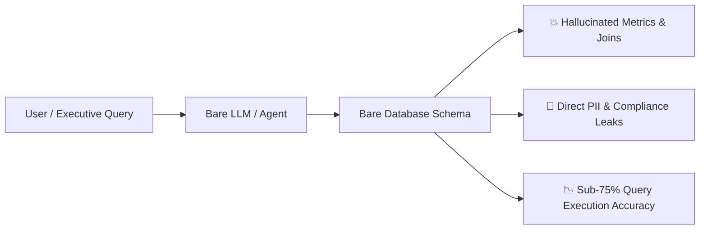

# ContextForge: Pitch Deck
## Autonomous Data Estate Intelligence for Enterprise AI

---

### Slide 1: The Executive Thesis
> **Generative AI cannot safely or accurately query enterprise data without an active, governed context layer.**

* Today, companies connect LLMs directly to bare data warehouses. The result is hallucinated joins, wrong business metrics, and silent PII leaks.
* ContextForge is the **governed intelligence layer** between your data estate and downstream AI agents: automatically profiling schemas, mapping deterministic column lineage, enforcing Policy-as-Code guardrails, and serving real-time context over the Model Context Protocol (MCP).

---

### Slide 2: The Real-World Problem

Enterprises are spending millions building "Talk-to-Data" conversational agents and text-to-SQL interfaces, yet over **80% fail in production**. Why?



1. **The Context Deficit (Silent Hallucinations & Broken Math)**:
   * Databases are built with cryptic column names (`usr_uid`, `tot_amt_curr`, `stat_cd`).
   * An LLM given bare DDL has no knowledge of business definitions, metric calculations (e.g., LTV vs. Net Revenue), or valid value ranges.
   * Result: Inaccurate joins, invalid groupings, and queries that fail or silently return wrong numbers.

2. **The Compliance Catastrophe (Unregulated PII Exposure)**:
   * AI agents have no innate sense of data privacy or compliance (GDPR, HIPAA, LGPD).
   * When asked for "customer purchase patterns," agents query and output raw names, phone numbers, and home addresses directly to unauthorized users.

3. **The Static Catalog Cemetery (Passive Human Wikis)**:
   * Legacy data catalogs (Collibra, Alation) are passive human wikis.
   * Documenting 10,000+ columns manually requires thousands of hours of steward time. Catalogs go stale the moment a data engineer pushes a new dbt migration.
   * Most critically: **Traditional catalogs cannot be consumed dynamically by AI agents at inference time.**

---

### Slide 3: Why Existing Approaches Fail

| Approach | What It Does | Why It Fails in Enterprise AI |
| :--- | :--- | :--- |
| **Direct Bare Schema** | Feeds `CREATE TABLE` DDL directly to LLM prompt. | High hallucination rate (27% failures on our benchmark); zero privacy protection. |
| **Vector RAG over Docs** | Embeds wiki pages / data dictionaries into a vector database. | Unstructured chunks lack relational foreign keys, schema topology, and column data types. |
| **Fine-Tuning Models** | Trains an LLM on historical queries. | Brittle, prohibitively expensive, cannot adapt to daily schema migrations, and lacks runtime security controls. |
| **Legacy Human Catalogs** | Web portals for data stewards to manually document schemas. | Static, perpetually out-of-date, and lacks agentic API protocols (MCP) for real-time inference. |

---

### Slide 4: The Solution — ContextForge

ContextForge transforms data cataloging from a **passive human chore** into an **autonomous, active governance runtime**:

```mermaid
flowchart TD
    Estate[Enterprise Data Estate<br/>PostgreSQL · DuckDB · Snowflake] --> Profiler[1. Statistical Profiler<br/>Non-LLM distributions, cardinality, nulls]
    Profiler --> Agents[2. Grounded Multi-Agent Ensemble<br/>Structured Pydantic JSON + Confidence Scores]
    Estate --> Lineage[3. AST Column Lineage Engine<br/>sqlglot parser · OpenLineage standard]
    Lineage --> Propagator[4. Recursive Tag Propagator<br/>PII tags traverse 3+ hops downstream]
    Agents --> Policy[5. Policy-as-Code Engine<br/>15 YAML rules gate all catalog writes]
    Policy -->|High Risk / Low Conf| Queue[6. Human Steward Approval Queue]
    Policy -->|Approved| Catalog[7. Relational Catalog & Parquet Lakehouse]
    Catalog --> MCP[8. Model Context Protocol (MCP) Server]
    MCP --> Client[Enterprise AI Agents<br/>Claude · ChatGPT · Cursor · BI Tools]
```

1. **Automated Grounded Enrichment**: Non-LLM statistical profilers extract null rates, cardinality ratios, and value distributions. Specialized LLM agents generate technical descriptions, glossary mappings, and quality checks with strict JSON Schema validation.
2. **Deterministic Column-Level Lineage**: An AST parser (`sqlglot`) traces dependencies across complex CTEs, window functions, and joins into OpenLineage 1.0.2 events.
3. **Multi-Hop Tag Propagation**: When a source column is tagged `PII`, the sensitivity tag automatically cascades downstream to all derived dimensions and marts with an unbroken reason chain.
4. **Policy-as-Code & Cryptographic Audit**: 15 declarative YAML policies intercept and validate every metadata change before commit. High-risk proposals route to human stewards; every change is appended to a SHA-256 hash-chained audit log.
5. **Model Context Protocol (MCP) Server**: Provides dynamic, role-governed schema context, column masking, and active policy guardrails to any AI client at inference time.

---

### Slide 5: Quantified Proof & Benchmark Results

We evaluated ContextForge against a 45-question Spider-style business query benchmark on a real 31-table enterprise estate (Olist e-commerce + Northwind wholesale) executing directly on DuckDB:

| Metric | Baseline (Bare Schema) | Governed ContextForge | Enterprise Impact |
| :--- | :---: | :---: | :--- |
| **Text-to-SQL Execution Match** | 73.33% (33/45) | **86.67% (39/45)** | **+13.34 pt accuracy uplift** (single run, one model) |
| **PII Classification F1** | — | **94.3%** (P: 96.2%, R: 92.6%) | Tested on independent held-out split of 94 unseen columns |
| **Column Lineage AST Accuracy** | — | **97.4%** (38/39 verified) | Deterministic dependency tracing across CTEs and window queries |
| **Governance Adversarial Defense** | 0% blocked | **87.0%** (20/23 blocked) | Intercepts unauthorized PII extraction attempts at inference |
| **Defect Detection Rate** | 0% caught | **62.5%** (5/8 caught) | Automated quality suite catches schema/null anomalies before production |
| **Catalog Enrichment Unit Cost** | Manual: ~$50/table | **$0.10 per 1,000 columns** | 500x cost reduction compared to human manual stewardship |

---

### Slide 6: What Makes ContextForge Different?

```mermaid
quadrantChart
    title Enterprise Data Intelligence Matrix
    x-axis Low Governance & Safety --> High Governance & Safety
    y-axis Static / Manual --> Active / Agent-Native
    quadrant-1 ContextForge
    quadrant-2 Autonomous Chaos
    quadrant-3 Raw Schemas / Ad-hoc SQL
    quadrant-4 Traditional Catalogs (Collibra, Alation)
    "Raw Schemas": [0.15, 0.20]
    "Traditional Catalogs": [0.85, 0.30]
    "Vector RAG": [0.35, 0.55]
    "Unregulated AI Agents": [0.20, 0.85]
    "ContextForge": [0.88, 0.90]
```

* **Not a Passive Catalog**: Actively intercepts, enriches, gates, and serves metadata directly to AI at runtime.
* **Not Vector RAG**: Operates on deterministic relational graphs, AST lineage trees, and statistical profiles—not fuzzy text embeddings.
* **Not a Black Box**: Built on OpenLineage, Model Context Protocol (MCP), and standard SQL Parquet lakehouses.

---

### Slide 7: Honest Engineering & Limitations

Unlike pitch decks that promise 100% magic, we document exactly where ContextForge breaks:
* **Unstructured Free-Text PII**: Regex and token classifiers catch structured identifiers (emails, UUIDs) but miss PII embedded in free-form delivery notes.
* **Correlated Scalar Subqueries**: AST resolution struggles with correlated subqueries evaluated as anonymous columns.
* **Relational Semantic Defects**: Schema rules catch null spikes and range violations, but miss cross-table business logic errors (e.g. `delivery_date < order_date`).
* **Paraphrased Prompt Injections**: Evasive phrasing can bypass keyword policy filters; blunt keyword rules produce a 13.0% false refusal rate on benign queries.

*Full details: [`docs/failures_and_limitations.md`](failures_and_limitations.md).*

---

### Slide 8: The Vision & Roadmap

* **Phase 1 (Shipped)**: Core engine, DuckDB/Postgres estate, AST lineage, Policy-as-Code, MCP server, web UI, 54-test suite.
* **Phase 2 (Next)**: Apache Iceberg & Delta Lake metadata connector, dbt semantic layer integration, and LLM-as-a-Judge real-time semantic policy gating.
* **Phase 3 (Enterprise)**: Distributed enterprise RBAC, SAML/Okta integration, multi-engine lineage (Snowflake + BigQuery + Databricks).

---

### Summary
ContextForge gives enterprise AI agents the **eyes to understand your schema** and the **guardrails to protect your data**.
